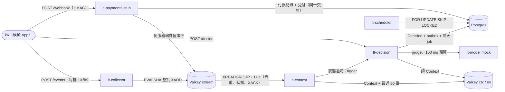

# realtime-decision-loadtest

> **Abstract.** A minimal working prototype of a real-time decision architecture for a live-streaming app,
> with the load tests, failure injections and invariant checks that measure it. At design load (about 155 events/s,
> 17 decisions/s) collector p99 is 2.1 ms and ingest-to-Context p99 is 4.0 ms. Seven failure injections leave all
> 16 invariants at 0 violations, and the stack reaches at least 14.5x baseline with 0 errors before the host red line.

直播 App 即時決策架構的最小可運作原型，加上量測它的壓測、故障注入與不變式檢查。細節與原始數字都在這裡。

[完整報告](REPORT.md) ・ [原始輸出](results/) ・ [License](LICENSE)

## 重點數字

| 數字 | 意思 | 條件 |
|---|---|---|
| p99 2.1 ms / 4.0 ms | collector 伺服器端 / 事件進入到 Context 套用 | T1 設計負載：每秒約 155 events、17 decisions，10 分鐘，錯誤 0 |
| 16 條 0 違反 | 不變式全部成立，故障時只會少做 | T3 七種故障注入；全部 39 輪測試都是 0 |
| 至少 14.5 倍 | 基準負載的倍數，0 錯誤 | T4；主機紅線（load 3.5）先停止 k6，這是下限 |
| ±0.3 MB / 小時 | 六個 Python 服務的記憶體斜率 | T2：60 分鐘、557,222 筆事件 |

## 測試總覽

| 測試 | 驗證什麼 | 負載與時長 | 結果 | 細節 |
|---|---|---|---|---|
| T1 | 設計負載撐得住 | 基準，10 分鐘 | `/decide` 伺服器端 p95 89 ms、p99 155 ms，多是模型 mock 延遲 | [報告](REPORT.md#t1-基準負載10-分鐘) ・ [輸出](results/t1_baseline) |
| T1-R | Rust 參考 collector | 同 T1 流量，5 分鐘 | CPU 秒 / 千事件 0.0416（Python 0.0885）；RSS 9.4 MB（Python 36 MB） | [報告](REPORT.md#t1-rrust-參考-collector5-分鐘) ・ [輸出](results/t1r_rust) |
| T2 | 長時間穩定 | 基準，60 分鐘 | 伺服器端 p99 與 T1 相同 | [報告](REPORT.md#t2-長時間60-分鐘基準負載) ・ [輸出](results/t2_soak) |
| T3 | 故障時只會少做 | 基準，七種注入一次一種 | 故障只造成不行動或延後 | [報告](REPORT.md#t3-故障注入基準負載一次一種) ・ [不變式](REPORT.md#不變式) ・ [輸出](results/t3_model_timeout) 等 `t3_*` |
| T4 | 容量 | k6 在主機 core 2，線性拉到目標 25 倍 | 每秒 247 次 decide、約 2,300 events；lt-decision 先飽和（0.44 / 0.5 vCPU） | [報告](REPORT.md#容量結果修正後t4_fixed目標-25-倍) ・ [輸出](results/t4_fixed) |
| T5 | 尖峰 | 目標 10 倍 60 秒，實際約 9.5 倍（k6 有 427 個 session 沒啟動） | 0 錯誤；decide p99 最高 155 ms；10 秒內恢復 | [報告](REPORT.md#t5-尖峰10-倍-60-秒再回到基準) ・ [輸出](results/t5_spike) |
| T6 | 快取層 A/B | Valkey 8.1、Redis 7.2、Dragonfly；150 到 4,000 events/s | Redis 與 Valkey 相近；Dragonfly 每事件 store CPU 是 3.5 到 4 倍。維持 Valkey | [報告](REPORT.md#t6-快取層-abvalkey-814redis-72dragonfly-138) ・ [輸出](results/t6) |
| T6b | 只用 Postgres 取代 Valkey | 逐階加量；設計尖峰是 150 events/s | tuned 到 4,800 events/s 符合 Context 讀取 p95 20 ms，9,600 失敗；naive 到 2,400 | [報告](REPORT.md#t6b只用-postgres-取代-valkeycontext-與事件流兩個角色) ・ [輸出](results/t6b_rerun) |
| T7 | 模型呼叫的成本：CPU、連線池、逾時取消、TLS、斷路器 | 1x、5x、13x | rnet 與 JSON 不到 Python 側忙碌樣本的 0.5%；斷路器把 p95 從 155 ms 降到 4.4 ms | [報告](REPORT.md#t7-模型呼叫的資源成本) ・ [輸出](results/t7_breaker_on) 等 `t7_*` |
| Postgres A/B | 預設與調校設定、定序、外鍵 | T1 負載每組 3 分鐘；pgbench 每組 60 秒 | 調校設定多 55% 到 70% TPS，全部來自 autovacuum 的兩個參數 | [報告](REPORT.md#postgres-設定pg-186) ・ [輸出](results/pg_c_tuned) 等 `pg_*`、`pgb_*` |
| 實作 A/B | 套件與寫入方式的 CPU | T1 負載 | v1 到最終版，collector 與 context 的 CPU 秒 / 千事件各少 24% 與 25% | [報告](REPORT.md#實作優化) ・ [輸出](results/p3_v3_profile) |

- **T3 的七種注入**：模型全逾時、Context 停機 60 秒、Valkey 暫停 10 秒、事件重送、webhook 重送、兩個 scheduler、偽造客戶端儲值。
- **T4**：Valkey 只用 0.27 核；lt-decision 的 p95 從約 100 ms 升到 174 ms。**T6**：Dragonfly 在 8,000 events/s 由 store 自己先滿。
- **T7 的 TLS**：保持連線時只多 2% CPU。每次新建 TLS 連線，每千次模型呼叫多約 1 CPU 秒（約每次呼叫 1 ms CPU），p50 多 1.7 到 3.4 ms。
- **T7 的歸屬**：0.5% 只算 Python 側可見的 frame；rnet 的 Rust 執行緒沒有歸屬。

## 受測系統

Python 服務都是 Python 3.13、Sanic 原生 server、uvloop、msgspec，每個容器一個 process。

| 服務 | 技術 | 角色 | 資源配額 |
|---|---|---|---|
| lt-collector | redis-py + hiredis | 驗證事件批次；壞事件進 quarantine；好事件用一個 Lua 腳本整批 XADD | 0.5 vCPU / 1 GB |
| lt-context | valkey-glide、rnet、cachebox | consumer group；去重、狀態更新、XACK 在同一個腳本；XAUTOCLAIM；送狀態逾時 Trigger | 0.5 vCPU / 1 GB |
| lt-decision | rnet、psqlpy、redis-py、cachebox、xxhash | `decide()`：冪等、arm = hash(user_id, salt)、模型 150 ms 預算、斷路器、護欄、outbox | 0.5 vCPU / 1 GB |
| lt-model | Sanic | System One mock：lognormal 延遲（中位數 40 ms、p95 120 ms）；`POST /admin/faults` 調逾時率、錯誤率與延遲 | 0.5 vCPU / 1 GB |
| lt-payments | psqlpy、redis-py | 付款後端 stub：HMAC 驗章、以交易 ID 去重、同一交易內兌付 | 0.5 vCPU / 1 GB |
| lt-scheduler | psqlpy | 壓縮時鐘的隔天決策；兩個 replica 可同時跑 | 0.5 vCPU / 1 GB |
| lt-redis | Valkey 8.1.4 | 事件 stream 與 Context | 1 vCPU / 1 GB |
| lt-pg | Postgres 18.6 | Decision、outbox、job、付款；設定在 `pg/postgresql.conf` | 1 vCPU / 2 GB |
| k6 | k6 2.3.0 | 合成 session；在 login、watch_30min、leave_room、cancel_recharge 同步呼叫 `/decide` | 本機，或主機 core 2 |

- 模型推論效能不在範圍內。付款也不在決策架構的範圍內：stub 只模擬架構依賴的三個保證。
- stub 送出的 `recharge`（`src=server`）代表一筆已完成的儲值（設計上的事件名稱是 `recharge_completed`）。
- 每個服務都有 `/metrics`（Prometheus）、`/stats`（JSON 百分位）與 `/admin/reset`。這些與 `/admin/*` 是沒有驗證的測試用路由，正式部署要移出對外的 listener。

## 這份壓測證明不了什麼

| 項目 | 為什麼 |
|---|---|
| AWS 託管服務 | ElastiCache、RDS、Fargate 的網路、CPU credit、儲存延遲與節流都和測試主機不同。0.5 vCPU 是 cgroup 配額，不是 Fargate vCPU。 |
| RDS 與 ElastiCache failover | 沒有測主節點切換、複寫延遲、切換期間的交易重試與冪等。持久化模型也不同。 |
| 真實模型延遲 | System One 是 mock。真模型的延遲分布、冷啟動、GPU 排隊都沒測。 |
| 真實網路 | 本機到主機只有一條 SSH tunnel（往返約 35 到 40 ms），不是行動網路或負載平衡器後面的路徑。 |
| 真實使用者行為 | 流量是合成 session，時鐘壓縮（「隔天」= 30 秒、狀態逾時 = 10 秒）。 |
| 長期資料量 | 從空表開始，最長 60 分鐘。數月資料下的索引、vacuum、分割區切換沒有量到。 |
| 鄰居干擾 | 主機同時跑其他服務。CPU 用量低，但 load 與記憶體頻寬會互相影響。 |
| 業務效果 | 轉換效果與統計檢定力不在範圍內。這裡只證明分組穩定、護欄不被違反。 |

## 測試後的修正

上面所有數字都來自修正前的程式碼。逐項說明在 [REPORT：測試後的修正](REPORT.md#測試後的修正2026-10-03)。

| 修正 | 影響熱路徑？ | 是否重測 |
|---|---|---|
| Context 套用腳本：去重標記移到所有狀態寫入之後 | 是 | 否 |
| Decision 只在 SQL 執行時持有 PG 連線 | 是 | 否 |
| Python 與 Rust collector 都只接受 signed 64-bit 整數 | 是（多一個範圍檢查） | 否 |
| 頻率上限的 key 加上 user_id | 指令數不變 | 否 |
| 斷路器探測、webhook 簽章、逾時 Trigger、新鮮度護欄、延遲 histogram、Context 啟動、腳本 | 否 | 否 |
| k6 計數分開隔離事件 | 只動量測工具 | 47 份 stats 的隔離計數都是 0，數字不變 |
| 容量判定：沒有成功樣本的階段判失敗 | 只動量測工具 | 重算 t6、t6b、t6b_rerun，判定不變 |

## 怎麼重跑

前置需求：Docker 與 Compose v2 以上、[k6](https://k6.io) 2.3、[uv](https://docs.astral.sh/uv/)。
密碼與 webhook secret 從環境變數讀。`compose.yaml` 的預設值（`lt-test-secret`、`lt-test-only`）只供測試。所有 port 只綁 127.0.0.1。

**單機快速跑**（不經 SSH，沒有紅線守衛）

1. `docker build -t lt-app:1 .`
2. `docker compose -p lt up -d`（`--profile dual` 加第二個 scheduler；`--profile tls` 加 nginx TLS，先跑 `scripts/make_test_cert.sh`）
3. `k6 run -e DURATION=10m k6/traffic.js`（基準負載）
4. `docker exec -i lt-pg psql -U lt -d lt < sql/invariants.sql`（每一列都必須是 0）
5. `docker compose -p lt down -v`

**遠端主機**（報告的數字都用這個流程）

1. `export LT_SSH=<ssh-alias>`
2. `scripts/deploy.sh`（rsync 原始碼、build lt-app:1、啟動 stack）
3. k6 在本機時，開 17101 到 17106 的 tunnel：`ssh -N -L 17101:127.0.0.1:17101 … -L 17106:127.0.0.1:17106 "$LT_SSH" &`
4. `scripts/run_test.sh <test-name> [k6 -e args...]`；各測試的指令在 REPORT 該節的「指令」行
5. T4：`K6_MODE=host scripts/run_test.sh t4_fixed -e PROFILE=stress -e PEAK_X=25 -e RAMP=270s -e MAX_VUS=<n>`
6. 實作 A/B：`scripts/ab_runs.sh`
7. 單元測試 `uv run pytest`；整合測試（對執行中的 stack）`LT_IT=1 uv run pytest tests/test_integration.py`

輸出寫到 `results/<test-name>/`（可提交）與 `results/private/<test-name>/`（主機原始快照，已列在 `.gitignore`）。

| 變數 | 預設 | 用途 |
|---|---|---|
| `LT_SSH` | 無 | 壓測主機的 ssh 別名 |
| `LT_REMOTE_DIR` | `lt-loadtest` | 主機上的部署目錄 |
| `K6_MODE` | 本機 | `host`：k6 在主機的 lt-k6 容器跑（core 2、lt-net），不經 tunnel |
| `K6_SCRIPT` | `k6/traffic.js` | k6 腳本 |
| `INJECT` | 無 | 測試期間在主機背景執行的故障注入 shell |
| `PROFILE_SECS`、`PROFILE_TARGETS` | 無；lt-collector lt-context | 同時錄 py-spy `--native` profile 的秒數與容器 |
| `POLL_SECS` | 無 | 每 n 秒輪詢 lt-decision 與 lt-model 的 `/stats` |
| `SKIP_INVARIANTS` | 無 | `1`：結束時不跑不變式 |
| `START_LOAD_MAX` | 2.0 | 主機 1 分鐘 load 降到這個值以下才開始 |
| `RATE`（k6 `-e`） | 5.3 | 每秒 session 數，5.3 是基準 |
| `PROFILE`（k6 `-e`） | `constant` | `constant`、`stress` 或 `spike` |
| `DUP`、`WEBHOOK_DUP`（k6 `-e`） | 關 | `1`：每個事件批次與 decision、或每個 webhook 送兩次 |
| `BAD_SIG`、`FORGE`（k6 `-e`） | 0 | 錯簽章 webhook 比例（例如 0.01）、偽造客戶端儲值比例（例如 0.2） |

| 項目 | 做法 |
|---|---|
| 紅線守衛 | `run_test.sh` 用 `scripts/remote/bg.sh` 啟動 `scripts/remote/guard.sh`，確認 PID 存活，否則拒跑。守衛每 2 秒檢查：1 分鐘 load 大於 3.5 或可用記憶體低於 6 GB，就寫入 `ABORT` 並停止 `lt-k6`、`lt-bench`、`lt-pgbench`。主機有其他服務時，依規格調整門檻。 |
| 清理 | `ssh <ssh-alias> 'bash -s -- "<UTC 開始時間，例如 2026-10-02 14:55>"' < scripts/remote/cleanup.sh` 只列出；加 `--apply` 才移除。只移除 `lt-` 容器、volume、network、本次拉取或建立的映像檔、開始時間之後的 build cache 與 `LT_REMOTE_DIR`，不做全域 prune。 |

## 測試抓到的問題

| 問題 | 後果 | 修正 |
|---|---|---|
| XACK 與 EVALSHA 在同一個非交易 pipeline | Valkey 重啟後腳本回 NOSCRIPT 沒套用，事件卻被確認而遺失（[results/script_restart](results/script_restart)） | XACK 移進套用腳本，放在每個 return 前 |
| 容器開檔上限 1024 | 約 1,000 條客戶端連線時服務拒絕連線；collector 的非阻塞連線池同時丟 MaxConnectionsError（[根因](REPORT.md#根因resultst4_rootcause)） | `nofile 65536`，改用 BlockingConnectionPool |
| rnet `no_keepalive=True` 沒有停止連線重用 | TIME_WAIT 維持 0，「每次新連線」那幾輪作廢 | 改用 `pool_max_idle_per_host=0` 重跑 |
| 腳本用空的 PID 檔停守衛與取樣器 | `kill` 沒有對象（[紅線事件](REPORT.md#紅線事件與執行中的錯誤)） | `bg.sh` 啟動時確認 PID 存活，停止時 PID 檔缺失或空白就報錯；`tests/test_bg.py` 重現 |

## 目錄結構

| 路徑 | 內容 |
|---|---|
| `lt/` | 六個 Python 服務與共用的決策邏輯（`logic.py`） |
| `k6/` | 流量腳本：`traffic.js`（完整 session）、`events_ramp.js`（只打 `/events`） |
| `sql/` | schema、16 條不變式、統計查詢 |
| `pg/` | Postgres 設定檔，每個參數一行理由 |
| `bench/` | T6 快取層與 T6b 只用 Postgres 的 driver |
| `rust-collector/` | Rust 參考 collector，與 Python 版同一份 wire contract |
| `baseline_v1/` | 實作 A/B 的 v1 版本 |
| `tls/` | T7 用的 nginx TLS 設定（憑證不提交） |
| `scripts/` | `run_test.sh`、各測試的批次腳本、分析工具 |
| `scripts/remote/` | 主機端：守衛、取樣、快照、背景行程管理、清理 |
| `tests/` | 單元測試與整合測試 |
| `results/` | 每個測試的原始輸出（`private/` 不提交） |
| `compose*.yaml` | 受測系統，與 Rust、io_uring、nofile 的覆寫檔 |
| `REPORT.md` | 完整報告（繁體中文） |

## License

MIT，見 [LICENSE](LICENSE)。Copyright (c) 2026 E-NoR。
